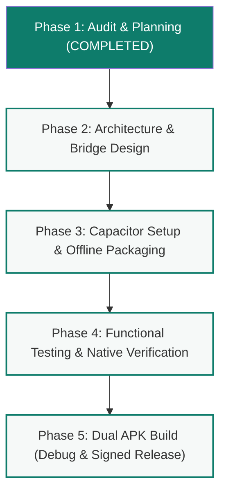

# Implementation Plan — PhotoPixC Learn Android APK
**Project:** PhotoPixC Learn Android Native Application (`com.photopixc.learn`)  
**Target:** 100% Free, Zero-Cost, Production-Grade Android APK  
**Companion Documents:** [AUDIT_REPORT.md](file:///F:/Antigravity/AUDIT_REPORT.md) | [FEATURE_FEASIBILITY.md](file:///F:/Antigravity/FEATURE_FEASIBILITY.md)  
**Phase:** Phase 1 — Comprehensive Implementation Roadmap  

---

## 1. Architectural Strategy & Safety Boundaries

### Zero-Regression Principle for Existing Web Production
The existing website (`https://learn.photopixc.com/`) is hosted on GitHub Pages / Cloudflare Edge directly from this repository. To guarantee **zero production damage**:
1. All web source files (`index.html`, `google-ads/`, `meta-ads/`, `skill-lab-45/`, `quranic-arabic/`, `shared/`) remain 100% intact and functional in standard web browsers.
2. Capacitor native configuration files (`capacitor.config.json`, `package.json`, `android/`) are added as modular, non-destructive layers.
3. Native bridge logic detects environment dynamically:
   ```javascript
   const isNativeAndroid = window.Capacitor && window.Capacitor.isNativePlatform();
   ```
   If loaded in a desktop or mobile browser, native plugins are safely ignored with zero console errors.

---

## 2. Target Project Directory Structure

```text
F:\Antigravity/
├── index.html                      # Root school portal (Unmodified)
├── portal.js                       # Portal navigation logic (Unmodified)
├── google-ads/                     # Google Ads & AI Marketing school (Unmodified)
├── meta-ads/                       # Meta Ads school (Unmodified)
├── skill-lab-45/                   # Skill Lab 45 school (Unmodified)
├── quranic-arabic/                 # Quranic Arabic school (Unmodified)
├── shared/                         # Shared CSS, tokens, and navigation (Unmodified)
│   └── fonts/                      # Offline bundled Bengali/Inter WOFF2 fonts
│
├── package.json                    # Capacitor & build dependencies
├── capacitor.config.json           # Native app configuration
├── resources/                      # High-res source icons and splash artwork
│   ├── icon.png                    # 1024x1024 app icon
│   └── splash.png                  # 2732x2732 splash screen
│
├── app-native-bridge.js            # Lightweight native handler (Back button, Push, StatusBar)
│
├── android/                        # Android Studio / Gradle Project (Generated by Capacitor)
│   ├── app/
│   │   ├── build.gradle            # App-level build config (MinSDK 22, TargetSDK 34)
│   │   └── src/main/
│   │       ├── AndroidManifest.xml # Permissions (POST_NOTIFICATIONS, INTERNET)
│   │       ├── assets/public/      # Bundled web content (100% offline access)
│   │       └── res/                # Mipmap icons, drawable splash, theme XMLs
│   └── build.gradle                # Project-level Gradle config
│
└── .github/workflows/
    └── build-apk.yml               # Free automated GitHub Actions cloud build pipeline
```

---

## 3. Phase-by-Phase Execution Roadmap



### Phase 1: Complete Audit & Plan (Current Stage)
- [x] Complete 15-point codebase audit (`AUDIT_REPORT.md`).
- [x] Complete feature feasibility & technology evaluation (`FEATURE_FEASIBILITY.md`).
- [x] Create comprehensive step-by-step implementation plan (`IMPLEMENTATION_PLAN.md`).
- [x] **STOP & PRESENT FINDINGS TO USER FOR EXPLICIT APPROVAL.**

---

### Phase 2: Native Bridge & Asset Preparation (Post-Approval)
1. **Initialize Package Manifest:**
   - Create clean `package.json` with `@capacitor/core`, `@capacitor/android`, `@capacitor/cli`, `@capacitor/app`, `@capacitor/splash-screen`, `@capacitor/status-bar`, and `@capacitor/local-notifications`.
2. **Capacitor Configuration (`capacitor.config.json`):**
   ```json
   {
     "appId": "com.photopixc.learn",
     "appName": "PhotoPixC Learn",
     "webDir": "www",
     "bundledWebRuntime": false,
     "server": {
       "androidScheme": "https"
     },
     "plugins": {
       "SplashScreen": {
         "launchShowDuration": 1500,
         "launchAutoHide": true,
         "backgroundColor": "#0b1f33",
         "androidSplashResourceName": "splash",
         "androidScaleType": "CENTER_CROP",
         "showSpinner": false
       },
       "StatusBar": {
         "style": "DARK",
         "backgroundColor": "#0e7c6b"
       },
       "LocalNotifications": {
         "smallIcon": "ic_stat_notification",
         "iconColor": "#0e7c6b"
       }
     }
   }
   ```
3. **Offline Font Embedding:**
   - Download Bengali web fonts (`Hind Siliguri`, `Noto Sans Bengali`) and `Inter` into `shared/fonts/` to ensure offline typography displays flawlessly on devices without pre-installed Bengali fonts.
4. **App Branding Generation:**
   - Create PhotoPixC teal icon assets and splash screen for all Android mipmap densities (`mdpi` to `xxxhdpi`).

---

### Phase 3: Android Project Integration & Core Logic
1. **Prepare Build Web Directory (`www`):**
   - Create a clean packaging script that bundles the root portal, sub-apps, and shared assets into `www/` for native sync without interfering with Git root files.
2. **Generate Native Android Project:**
   - Run `npx cap add android` to generate the Gradle project.
3. **Implement Native Bridge (`app-native-bridge.js`):**
   - **Hardware Back Button Navigation Algorithm:**
     ```javascript
     // Safe, multi-layered back button handling
     App.addListener('backButton', () => {
       // Layer 1: Check open sidebars/menus
       const openSidebar = document.querySelector('#sidebar.open, .sidebar.open, .drawer.active');
       if (openSidebar) {
         openSidebar.classList.remove('open', 'active');
         return;
       }
       // Layer 2: Check open modal / interactive tool overlay
       const openModal = document.querySelector('.modal.active, .popup.open, dialog[open]');
       if (openModal) {
         if (openModal.close) openModal.close();
         else openModal.classList.remove('active', 'open');
         return;
       }
       // Layer 3: If on a lesson page, navigate back to Syllabus
       const hash = window.location.hash;
       if (hash.startsWith('#g-lesson-') || hash.startsWith('#ai-module-') || hash.startsWith('#m-lesson-')) {
         window.location.hash = '#syllabus';
         return;
       }
       // Layer 4: If on sub-app home, navigate back to Root Portal
       const isSubApp = window.location.pathname.includes('/google-ads/') || 
                            window.location.pathname.includes('/meta-ads/') || 
                            window.location.pathname.includes('/quranic-arabic/') ||
                            window.location.pathname.includes('/skill-lab-45/');
       if (isSubApp && (hash === '' || hash === '#home')) {
         window.location.href = '../index.html';
         return;
       }
       // Layer 5: If in Root Portal home, exit app
       App.exitApp();
     });
     ```
   - **Local Push Notifications Scheduler:**
     ```javascript
     // Daily 8:00 PM study reminder
     async function scheduleDailyStudyReminder() {
       const perm = await LocalNotifications.requestPermissions();
       if (perm.display === 'granted') {
         await LocalNotifications.schedule({
           notifications: [
             {
               title: 'PhotoPixC Learn — আজকের পাঠ',
               body: '📖 প্রতিদিন মাত্র ৫ মিনিট! আজ একটি নতুন কনসেপ্ট শিখুন এবং কুইজ সম্পন্ন করুন।',
               id: 101,
               schedule: {
                 on: { hour: 20, minute: 0 },
                 repeats: true,
                 allowWhileIdle: true
               },
               smallIcon: 'ic_stat_notification'
             }
           ]
         });
       }
     }
     ```
   - **Browser Progress Migration (Import/Export Assistant):**
     - Add an unobtrusive native UI card inside settings/portal allowing students to pick their exported `google-ads-learning-backup.json` to instantly hydrate their app `localStorage`.

---

### Phase 4: Testing & Verification Matrix

| Test Case | Procedure | Expected Result | Pass Criteria |
| :--- | :--- | :--- | :--- |
| **TC-01: Cold Start & Splash** | Launch APK from phone home screen | Splash screen displays `#0b1f33` background with PhotoPixc logo for 1.5s, then main portal loads | No white screen flash; load time < 1s |
| **TC-02: Offline Flight Mode** | Enable Airplane Mode (WiFi & Mobile Data OFF), open app | All 5 schools, 102 lessons, quizzes, and AI tools open and render Bengali text properly | 100% of text, diagrams, and quizzes functional |
| **TC-03: Back Button Navigation** | Navigate: Portal $\to$ Google Ads $\to$ Lesson 15 $\to$ Press Android Hardware Back | Navigates back to Syllabus `#syllabus`; second back press returns to Portal; third exits app | No unexpected app exits or broken history |
| **TC-04: Progress Persistence** | Mark 3 lessons completed, answer quiz, kill app, reboot phone, relaunch app | Completed lessons and quiz score remain accurately checked | `localStorage` intact across device reboot |
| **TC-05: Data Migration** | Export backup JSON on Chrome browser, transfer file, import into APK via file picker | All Chrome progress successfully populates inside the APK | Zero data loss or corruption |
| **TC-06: Local Notification** | Schedule test notification 1 minute ahead | Notification banner pops up at target time with teal icon and Bengali text | Sound and heads-up banner trigger correctly |

---

### Phase 5: Dual APK Build Pipelines (Local & GitHub Actions CI)

Because the user's local machine currently does not have Java/Android SDK installed, we establish two robust pathways:

#### Pathway A: Cloud Automated Build via GitHub Actions (Zero Local Setup)
- **File:** `.github/workflows/build-apk.yml`
- **Cost:** $0.00 (GitHub provides 2,000 free runner minutes per month for public/private repos).
- **Environment:** Ubuntu-latest runner with Java 17 and Android SDK 34 pre-installed.
- **Workflow Steps:**
  1. Checkout repository (`actions/checkout@v4`).
  2. Setup Node.js and run `npm install`.
  3. Package assets and run `npx cap sync android`.
  4. Run Gradle build: `./gradlew assembleDebug` (for debug APK) and `./gradlew assembleRelease` (for release APK).
  5. Upload generated `.apk` files as workflow downloadable release artifacts.
- **Advantage:** User does NOT need to download 15 GB of Android Studio or configure environment variables on their Windows machine.

#### Pathway B: Local Build Guide (For Offline Local Development)
- Step-by-step instructions for installing OpenJDK 17 and Android Command-line Tools (or Android Studio) locally on Windows.
- Running:
  ```powershell
  npx cap sync android
  cd android
  .\gradlew assembleDebug
  ```
- Output location: `android/app/build/outputs/apk/debug/app-debug.apk`.

---

## 4. Immediate Next Steps (Pending User Approval)

1. **User Reviews Phase 1 Findings:**
   - Review [AUDIT_REPORT.md](file:///F:/Antigravity/AUDIT_REPORT.md)
   - Review [FEATURE_FEASIBILITY.md](file:///F:/Antigravity/FEATURE_FEASIBILITY.md)
   - Review this [IMPLEMENTATION_PLAN.md](file:///F:/Antigravity/IMPLEMENTATION_PLAN.md)
2. **User Authorizes Phase 2:**
   - Once the user gives confirmation, proceed with Phase 2 (project manifest, native bridge, font bundling, and Capacitor initialization).
